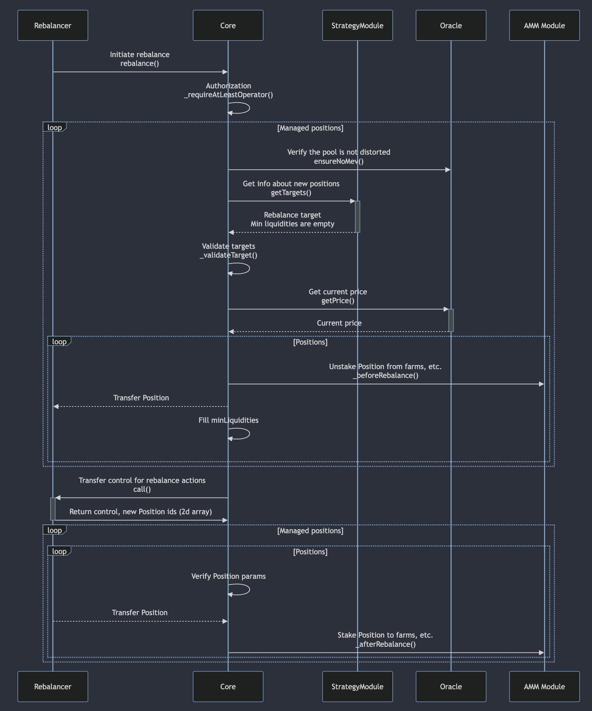
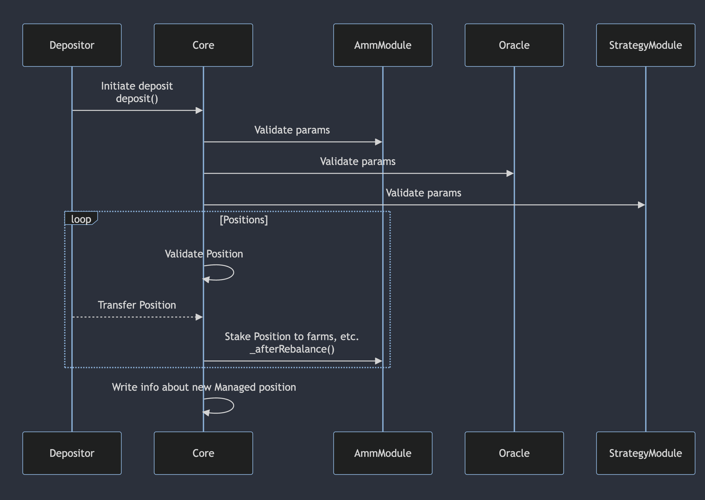
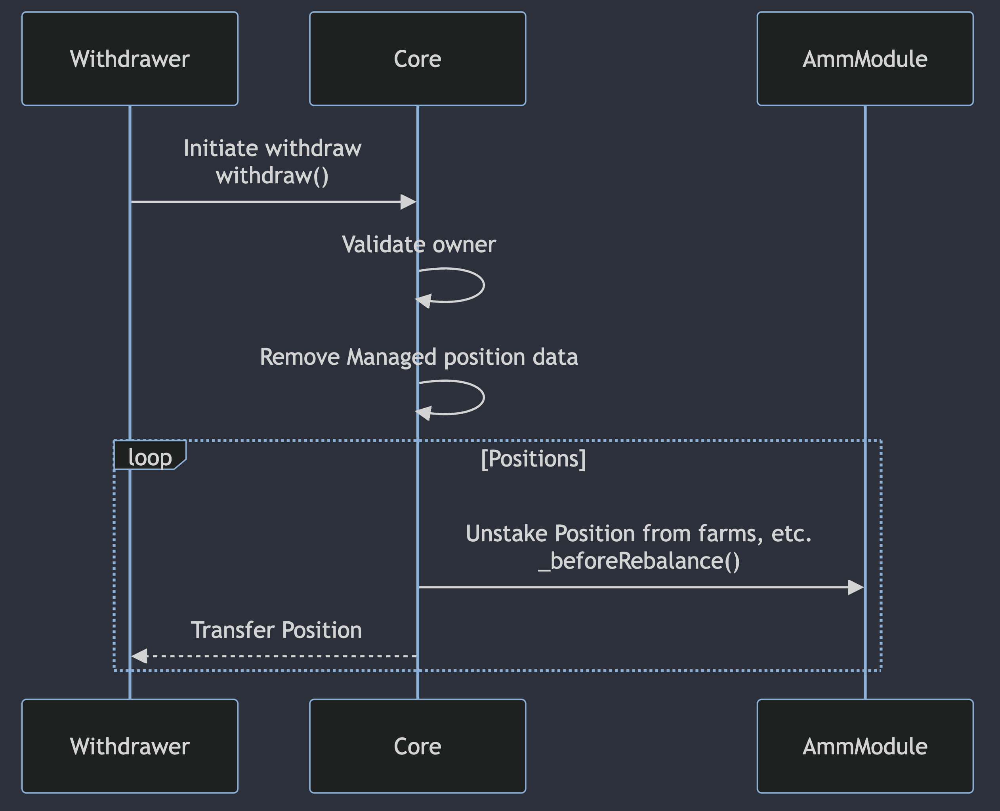

<Info>
**Legacy architecture.** Mellow ALM is an earlier generation of Mellow vault infrastructure, documented for existing deployments. [Core Vaults](/core-vaults/overview) are Mellow's current vault architecture.
</Info>

### Rebalance process

<Frame>
  
</Frame>

### Deposit process

<Frame>
  
</Frame>

### Withdraw process

<Frame>
  
</Frame>
