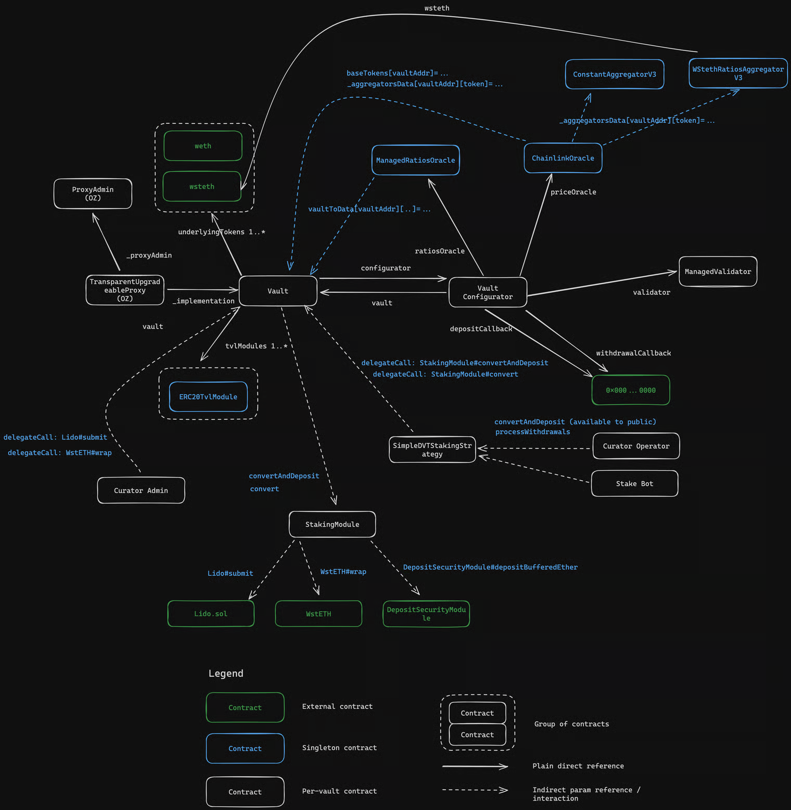

<Info>
**Legacy architecture.** Mellow-LRT is an earlier generation of Mellow vault infrastructure, documented for existing deployments. [Core Vaults](/core-vaults/overview) are Mellow's current vault architecture.
</Info>

<Frame>
  
</Frame>
